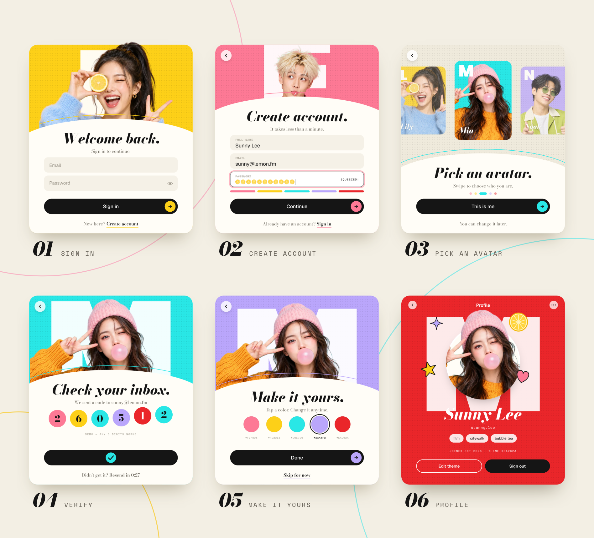
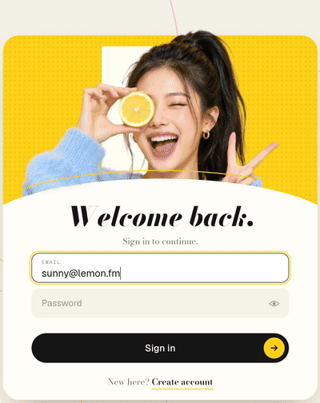
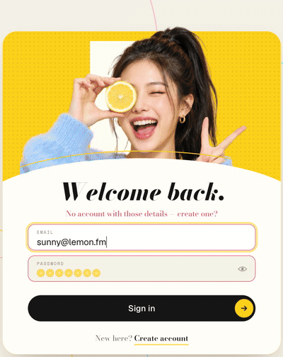
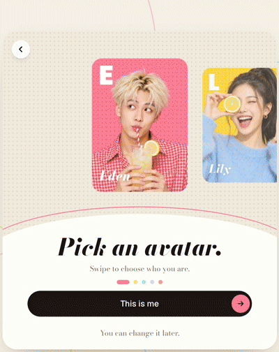
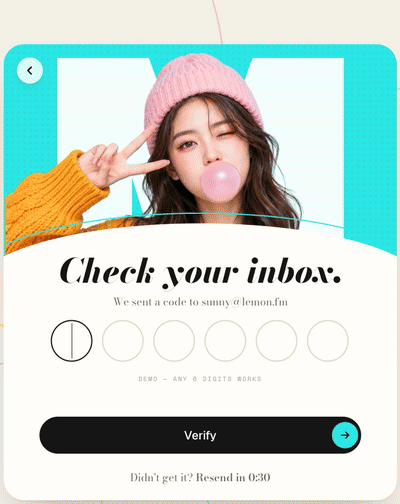
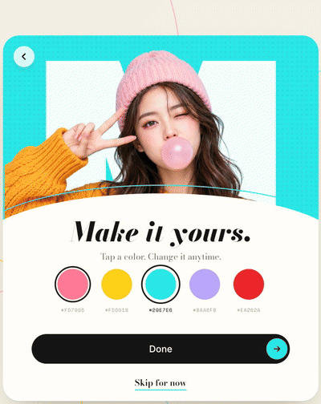
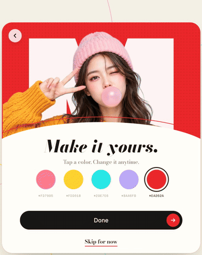
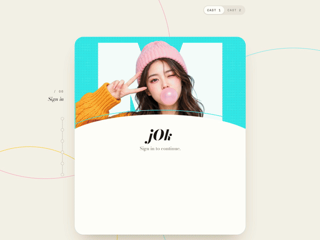

# Sign-up flow · 可交互网页源码

一个完整可交互的「登录 / 注册」流程页面，纯 HTML + CSS + JavaScript，**无框架、无构建、无依赖**。
直接双击 `index.html` 即可在浏览器打开，也可以原样部署到任何静态托管（GitHub Pages、Vercel、Netlify、OSS…）。


<p align="center">
  
</p>

## 亮点

<table>
  <tr>
    <td width="50%" valign="top">
      <br>
      <b>01 · 柠檬片密码</b><br>
      每输入一位就多一片柠檬；眼睛按钮切换明文；账号不对时字段抖动、副标题变红提示。
    </td>
    <td width="50%" valign="top">
      <br>
      <b>02 · 弹性卡片 + 强度条</b><br>
      底部圆弧卡片弹性升起，标题乱码重排；五色强度条从 <code>Sour</code> 一路涨到 <code>Squeezed!</code>
    </td>
  </tr>
  <tr>
    <td width="50%" valign="top">
      <br>
      <b>03 · 能甩的头像条</b><br>
      拖动、甩动、点击、方向键都能选，带惯性和弹簧回弹；主题色跟随中间的头像，「This is me」后头像探出卡片。
    </td>
    <td width="50%" valign="top">
      <br>
      <b>04 · 验证码</b><br>
      自动跳格、退格回退、整段粘贴、填满自动提交；柠檬片转圈 → 对勾 → 数字波浪跳动。
    </td>
  </tr>
  <tr>
    <td width="50%" valign="top">
      <br>
      <b>05 · 主题色扩散</b><br>
      点色块换主题色，新颜色从被点的色块处圆形扩散开；也支持方向键切换。
    </td>
    <td width="50%" valign="top">
      <br>
      <b>06 · 翻转个人卡片</b><br>
      卡片翻面成个人主页：头像破框、名字解码、贴纸依次落下。右上角 Cast 1 / Cast 2 一键换一组角色。
    </td>
  </tr>
</table>

<details>
<summary><b>▶ 完整流程（约 36 秒）</b></summary>
<br>

</details>

## 更多细节

- **一步步回退**：每一步卡片左上角都有返回按钮，浏览器后退键、手机返回手势也同样逐步回退（每一步都是一条浏览器历史记录）。
  - 回退顺序：资料卡 → 主题色 → 验证码 → 挑头像 → 注册 → 登录，前进键可以再走回去。
  - 回退后已填写的内容都会保留；验证码已经通过的，回到那一步显示「Continue」，不需要重新验证。
  - 退出登录后，后退不会回到已登录的步骤。
- 首次打开时每拍换一个角色作为开场；之后再访问会记住你的头像、主题色和邮箱。
- 左侧步骤栏的数字随步骤滚动切换（01 → 06）。
- 适配桌面与手机：卡片按视口等比缩放，窄屏隐藏两侧装饰栏。
- 支持键盘操作、屏幕阅读器标签，以及系统「减少动态效果」设置（会关闭动画）。

## 文件结构

```
index.html            页面结构（各步骤的表单都在这里）
css/style.css         全部样式；卡片以 660×764 设计尺寸绘制，再用 --k 缩放
js/cast.js            角色数据（名字、主题色、脸部坐标）+ 首字母字形轮廓
js/app.js             交互逻辑：屏幕切换、弹簧动画、拖动、验证码、主题、个人卡片
assets/img/cast1|2/   角色抠图（WebP，透明背景，720×960），单独授权见 assets/img/LICENSE.md
assets/fonts/         字体文件 + 各自的 OFL 授权原文
docs/                 README 用到的截图和动图（不影响页面运行）
LICENSE               代码授权：CC BY-NC-SA 4.0
```

## 接入真实后端

所有与服务器有关的逻辑都集中在 `js/app.js` 顶部的 `api` 对象里，目前是用 `localStorage` 模拟的演示实现：

```js
const api = {
  async signUp({ name, email, password }) { ... },   // 注册
  async signIn(email, password) { ... },             // 登录，失败返回 null
  async sendCode(email) { ... },                     // 发送验证码
  async verifyCode(email, code) { ... },             // 校验验证码（演示：任意 6 位数字都通过）
  async saveProfile(patch) { ... },                  // 保存头像 / 主题等资料
};
```

把这几个函数替换成你自己的接口请求即可，界面代码不需要改。
⚠️ 演示版把账号存在浏览器本地，仅用于展示；正式环境请勿在前端保存密码。

## 自定义

- **换角色 / 配色**：编辑 `js/cast.js`。每个角色需要：
  - `c`：主题色
  - `ink`：主题色上的文字颜色
  - `name`：名字
  - `face`：脸部中心坐标，按 1086×1448 原图计算
  - `ldx`：首字母相对脸的水平偏移

  另有两个顺序列表：`hook` 是开场轮换顺序，`pick` 是头像条和色块的顺序。
- **换文案**：标题和副标题在 `app.js` 的 `SCREENS`，按钮和表单文字在 `index.html`。
- **动画手感**：弹簧参数在 `app.js` 的 `tick()` 里：
  - 卡片升降：刚度 170、阻尼 15
  - 头像条：刚度 220、阻尼 18

## 浏览器支持

Chrome / Edge 104+、Safari 15.4+、Firefox 105+（用到了 Web Animations、CSS `translate/scale` 独立属性、`clip-path` 动画、Pointer Events）。
